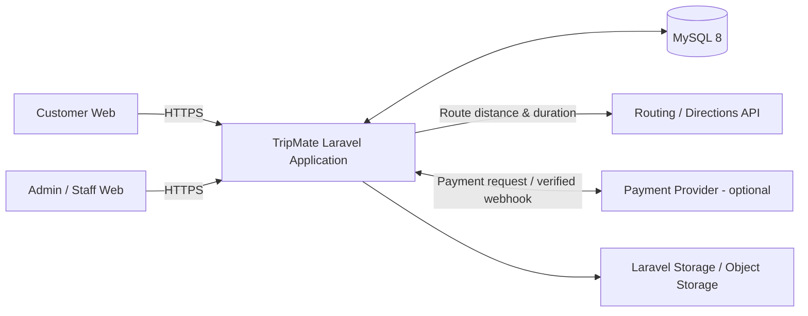
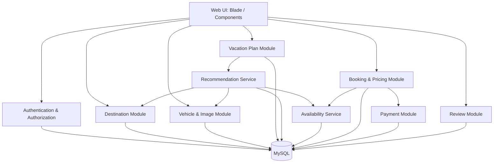

# Arsitektur Sistem — TripMate

**Versi:** 1.0  
**Status:** Draft arsitektur awal  
**Tanggal:** 26 Oktober 2026

## 1. Tujuan Dokumen

Dokumen ini menjelaskan struktur teknis TripMate, pembagian tanggung jawab aplikasi, alur data, integrasi eksternal, dan aturan implementasi utama. Arsitektur dirancang sebagai **modular monolith Laravel** untuk MVP: lebih sederhana dideploy dan dipelihara daripada microservices, tetapi domain tetap dipisahkan agar mudah dikembangkan.

## 2. Stack Teknologi yang Disarankan

| Area | Pilihan awal | Catatan |
|---|---|---|
| Backend | Laravel 12, PHP 8.3+ | Mengikuti asumsi proyek saat ini; verifikasi versi runtime saat setup. |
| Database | MySQL 8 | Foreign key, index, transaksi, dan JSON untuk kemampuan kendaraan. |
| Frontend | Blade + komponen UI responsif; bisa memakai Livewire/Vue jika kebutuhan interaksi berkembang | Jangan menambah framework SPA jika belum diperlukan. |
| Authentication | Laravel auth starter kit yang dipilih tim | Terapkan role middleware dan policy. |
| File storage | Laravel Storage (local saat development, object storage bila produksi membutuhkan) | Simpan path, bukan binary image, pada database. |
| Routing/directions | Provider routing API yang dipilih tim | Dibungkus adapter agar provider dapat diganti. |
| Payment | Pembayaran manual dahulu atau adapter payment gateway | Provider belum ditentukan; jangan mengunci domain ke satu provider. |
| Queue/cache | Laravel Queue/Cache bila diperlukan | Gunakan driver yang sesuai lingkungan deployment. |
| Testing | PHPUnit/Pest, Laravel feature tests | Wajib untuk availability, pricing, authorization, dan recommendation. |
| Deployment | Web server + PHP-FPM/container sesuai infrastruktur | Secrets melalui environment; HTTPS wajib di produksi. |

## 3. Gaya Arsitektur

**Modular monolith** dalam satu aplikasi Laravel dengan modul/domain:
1. Identity & Access
2. Destinations
3. Fleet / Vehicles
4. Vacation Planning
5. Recommendation Engine
6. Booking & Availability
7. Payments
8. Reviews
9. Admin Operations

Modul berkomunikasi melalui service class dan model/repository yang jelas. Hindari membuat microservice terpisah untuk MVP karena menambah biaya operasional, jaringan, observability, dan konsistensi data.

## 4. Diagram Konteks



Payment Provider bersifat opsional sesuai keputusan bisnis. Jangan menganggap integrasi payment gateway sudah tersedia sebelum provider dipilih dan konfigurasi dibuat.

## 5. Diagram Modul Aplikasi



## 6. Struktur Direktori yang Disarankan

Contoh struktur yang mengikuti konvensi Laravel dan memisahkan logika bisnis:

```text
app/
├── Enums/
│   ├── UserRole.php
│   ├── VehicleStatus.php
│   ├── VacationPlanStatus.php
│   ├── BookingStatus.php
│   └── PaymentStatus.php
├── Http/
│   ├── Controllers/
│   │   ├── Customer/
│   │   │   ├── DestinationController.php
│   │   │   ├── VehicleController.php
│   │   │   ├── VacationPlanController.php
│   │   │   ├── RecommendationController.php
│   │   │   ├── BookingController.php
│   │   │   └── ReviewController.php
│   │   └── Admin/
│   │       ├── DashboardController.php
│   │       ├── DestinationController.php
│   │       ├── VehicleController.php
│   │       ├── BookingController.php
│   │       ├── PaymentController.php
│   │       └── MaintenanceController.php
│   ├── Middleware/
│   └── Requests/
│       ├── StoreVacationPlanRequest.php
│       ├── StoreBookingRequest.php
│       └── StoreVehicleRequest.php
├── Models/
│   ├── User.php
│   ├── Destination.php
│   ├── Vehicle.php
│   ├── VehicleImage.php
│   ├── VacationPlan.php
│   ├── VehicleRecommendation.php
│   ├── Booking.php
│   ├── Payment.php
│   ├── VehicleMaintenance.php
│   └── Review.php
├── Policies/
├── Services/
│   ├── Recommendation/
│   │   ├── RecommendationService.php
│   │   ├── VehicleEligibilityFilter.php
│   │   ├── VehicleScorer.php
│   │   └── RecommendationReasonBuilder.php
│   ├── Availability/
│   │   └── VehicleAvailabilityService.php
│   ├── Booking/
│   │   └── BookingPricingService.php
│   ├── Routing/
│   │   ├── RoutingServiceInterface.php
│   │   └── Providers/
│   │       └── SelectedRoutingProvider.php
│   └── Payments/
│       ├── PaymentGatewayInterface.php
│       └── Providers/
│           └── SelectedPaymentProvider.php
└── Jobs/
    └── (opsional untuk pekerjaan async)

database/
├── migrations/
├── factories/
└── seeders/

resources/
├── views/
│   ├── customer/
│   └── admin/
└── ...

routes/
├── web.php
└── (route file tambahan jika benar-benar dibutuhkan)

tests/
├── Feature/
└── Unit/
```

Nama file adalah rekomendasi struktur, bukan file yang otomatis dibuat oleh dokumen ini. Jangan membuat abstraction/interface yang tidak dibutuhkan; interface routing dan payment berguna karena keduanya bergantung pada provider eksternal.

## 7. Model Data dan Relasi

Skema utama berasal dari workbook database yang diberikan:

- `users` 1:N `vacation_plans`
- `destinations` 1:N `vacation_plans`
- `vacation_plans` 1:N `vehicle_recommendations`
- `vehicles` 1:N `vehicle_recommendations`
- `vehicles` 1:N `vehicle_images`
- `users` 1:N `bookings`
- `vacation_plans` 1:N `bookings` (opsional pada booking)
- `vehicles` 1:N `bookings`
- `bookings` 1:N `payments`
- `vehicles` 1:N `vehicle_maintenance`
- `bookings` 1:0..1 `reviews`

### Catatan desain database
- Gunakan foreign key dan index pada foreign key serta kolom yang sering dipakai untuk pencarian.
- `users.email`, `destinations.slug`, `vehicles.vehicle_code`, dan `bookings.booking_code` harus unik.
- `reviews.booking_id` unik untuk membatasi satu review per booking.
- `vehicle_images.image_path` menyimpan path file.
- `vehicles.suitable_terrain` dan `suitable_road_conditions` berupa JSON sesuai rancangan. Validasi struktur JSON melalui Form Request/domain service.
- Simpan harga snapshot di `bookings`, bukan menghitung ulang riwayat transaksi dari `vehicles.daily_rate`.
- Simpan jarak, durasi, dan sumber routing sebagai snapshot pada `vacation_plans`.
- Pertimbangkan soft deletes untuk entitas operasional yang tidak boleh hilang dari riwayat transaksi; jika digunakan, atur dampaknya pada foreign key dan query availability.
- Tetapkan aturan `ON DELETE` secara eksplisit. Untuk data transaksi, umumnya lebih aman mempertahankan histori daripada menghapus cascade tanpa pertimbangan.

## 8. Alur Rekomendasi Kendaraan

### 8.1 Input
`destination_id`, titik awal/alamat dan koordinat bila ada, tanggal sewa, jumlah penumpang, tingkat bagasi, tipe perjalanan, budget opsional, kebutuhan sopir, dan persyaratan khusus.

### 8.2 Pipeline
1. **Validate request** — cek field wajib, tanggal, rentang nilai, dan kepemilikan vacation plan.
2. **Resolve route** — panggil routing adapter jika koordinat/titik awal tersedia; simpan jarak/durasi/source bila berhasil.
3. **Load candidate vehicles** — ambil kendaraan aktif dan data spesifikasi yang relevan.
4. **Hard eligibility filter** — kapasitas, status, ketersediaan tanggal, maintenance, medan/kondisi jalan, budget keras jika diaktifkan, dan kebutuhan wajib.
5. **Score eligible candidates** — hitung skor komponen yang dinormalisasi.
6. **Sort and persist** — urutkan skor tertinggi, simpan `vehicle_recommendations`, `rank_position`, `match_score`, komponen skor, alasan, dan `algorithm_version`.
7. **Return result** — kirim hasil beserta alasan dan status data yang belum tersedia.

### 8.3 Skor awal
Bobot awal yang bisa dikonfigurasi:
- Terrain & road fit: 30%
- Passenger & luggage capacity: 20%
- Distance/range/efficiency fit: 20%
- Budget fit: 20%
- Comfort, driver, transmission, facilities: 10%

Skor akhir berada di rentang 0–100. Untuk komponen yang tidak memiliki data, jangan otomatis memberi nilai sempurna. Pilih strategi eksplisit: normalisasi bobot pada komponen yang tersedia atau tandai rekomendasi sebagai berbasis data parsial.

### 8.4 Pseudocode
```text
plan = validateAndLoadVacationPlan(input)
route = routingService.estimate(plan.origin, plan.destination)

if route.success:
    persistRouteSnapshot(plan, route)

candidates = vehicles.active()
candidates = filterCapacity(candidates, plan)
candidates = filterTerrainAndRoad(candidates, plan.destination)
candidates = filterDriverAndRequirements(candidates, plan)
candidates = filterBudgetIfHardLimit(candidates, plan)
candidates = availabilityService.removeConflicts(
    candidates, plan.start_date, plan.end_date
)

ranked = scoreAndSort(candidates, plan, route)
persistRecommendations(plan, ranked, algorithmVersion)

return ranked
```

## 9. Routing API Abstraction

Gunakan `RoutingServiceInterface` agar business logic tidak bergantung langsung pada SDK/provider. Kontrak konseptual:
- Input: titik asal, destinasi, opsi perjalanan yang didukung.
- Output sukses: jarak km, durasi menit, nama provider, timestamp pengambilan, dan metadata seperlunya.
- Output gagal: status kegagalan yang aman untuk logging; jangan mengarang jarak atau menampilkan pesan teknis rahasia ke customer.

Hal yang harus ditangani:
- timeout dan retry terbatas;
- rate limit/quota;
- koordinat tidak tersedia/tidak valid;
- provider tidak menemukan rute;
- kebijakan cache sesuai ketentuan provider;
- API key hanya di server/environment;
- timestamp data agar pengguna tahu estimasi bisa berubah.

## 10. Availability dan Pencegahan Double Booking

Ketersediaan tidak boleh ditentukan hanya oleh `vehicles.is_available`. Status tersebut merupakan status umum unit; konflik harus dihitung dari rentang waktu.

Unit dianggap tidak tersedia bila:
- ada booking dengan status yang memblokir unit dan rentang waktunya overlap; atau
- ada periode maintenance yang memblokir unit dan overlap.

Pola overlap umum untuk rentang waktu `[pickup, return)`:
```text
existing.pickup_datetime < requested.return_datetime
AND existing.return_datetime > requested.pickup_datetime
```

Sebelum create/confirm booking:
1. Validasi ulang tanggal, harga, status unit, dan konflik.
2. Jalankan proses dalam `DB::transaction()`.
3. Gunakan strategi locking/serialisasi yang sesuai agar dua request bersamaan tidak lolos bersamaan.
4. Terapkan kebijakan status `pending`: apakah status ini menahan unit dan kapan hold kedaluwarsa.
5. Tambahkan integration/concurrency tests pada database yang sama dengan target produksi.

Locking baris kendaraan saja perlu dirancang hati-hati karena konflik rentang waktu bukan unique constraint sederhana. Pastikan semua jalur pembuatan/konfirmasi booking memakai service availability yang sama dan transaksi yang sama.

## 11. Booking dan Pricing

`BookingPricingService` menghitung:
- durasi tagihan sesuai kebijakan rental;
- `daily_rate_snapshot`;
- `subtotal`;
- `discount_amount`;
- `additional_fee`;
- `deposit_amount`;
- `total_amount`.

Semua nominal dihitung di server dengan tipe decimal/money-safe, bukan dari nilai total yang dikirim browser. Definisikan apakah deposit termasuk total yang dibayar sekarang atau dicatat terpisah. Jangan menyamakan total sewa, deposit, dan jumlah pembayaran tanpa aturan eksplisit.

Booking harus menyimpan snapshot tarif dan biaya agar perubahan tarif kendaraan tidak mengubah transaksi yang sudah dibuat.

## 12. Pembayaran

Pisahkan domain booking dan payment:
- Booking menyatakan reservasi/status sewa.
- Payment mencatat satu atau lebih percobaan/transaksi pembayaran.

Untuk pembayaran manual, staff dapat memverifikasi bukti dan memperbarui status sesuai permission. Untuk gateway:
- Gunakan interface/adapter provider.
- Verifikasi signature webhook di server.
- Terapkan idempotency agar webhook yang sama tidak diproses berkali-kali.
- Catat reference ID provider secara unik jika tersedia.
- Jangan menganggap redirect browser sebagai bukti pembayaran berhasil.
- Jangan menyimpan data kartu sensitif di database TripMate.

## 13. Keamanan dan Otorisasi

- Terapkan middleware auth dan role/policy untuk route customer, staff, dan admin.
- Pastikan customer hanya dapat membaca/mengubah vacation plan, booking, payment, dan review miliknya sendiri.
- Validasi semua input melalui Form Request dan aturan domain.
- Gunakan CSRF protection untuk web session.
- Simpan password dengan hashing Laravel.
- Batasi tipe/ukuran file, gunakan nama file aman, dan simpan melalui Storage.
- Jangan menaruh API key, kredensial database, atau secret payment di Git.
- Tambahkan rate limiting untuk login, recommendation endpoint, dan operasi sensitif.
- Hindari menampilkan stack trace/secret pada production.
- Untuk perubahan status pembayaran/booking, simpan actor dan timestamp dalam audit log bila fitur audit diterapkan.

## 14. Observability dan Penanganan Error

Log secara terstruktur:
- correlation/request ID bila tersedia;
- kegagalan routing provider;
- perubahan status booking/payment;
- kegagalan validasi konflik;
- exception operasional.

Jangan mencatat password, token, nomor kartu, atau data pribadi yang tidak diperlukan. Gunakan monitoring untuk error rate, latency, job failure, serta kegagalan integrasi. Pesan ke pengguna harus membantu tanpa membocorkan detail internal.

## 15. Strategi Pengujian

### Unit tests
- Kalkulasi skor dan normalisasi bobot.
- Hard filters (kapasitas, medan, budget, kebutuhan sopir).
- Kalkulasi harga dan durasi rental.
- Builder alasan rekomendasi.
- Deteksi overlap tanggal.

### Feature tests
- Customer dapat menggunakan alur rekomendasi.
- Customer dapat memilih mobil secara manual.
- Customer tidak dapat mengakses data customer lain.
- Admin/staff hanya dapat mengakses fungsi sesuai role.
- Kendaraan maintenance/booking konflik tidak ditampilkan sebagai tersedia.
- Booking menyimpan snapshot harga.
- Review hanya bisa dibuat setelah booking selesai dan satu kali per booking.
- Pembayaran tidak berubah menjadi paid hanya karena redirect client.

### Integration tests
- Routing adapter dengan response sukses, timeout, dan no-route.
- Payment webhook dengan signature valid/tidak valid dan event duplikat.
- Concurrency test untuk dua booking pada kendaraan dan waktu yang sama.

## 16. Strategi Deployment

Lingkungan minimum:
- Development lokal.
- Staging untuk uji integrasi dan UAT.
- Production dengan HTTPS, database backup, secret management, dan monitoring.

Checklist produksi:
- `APP_DEBUG=false`.
- Secrets disimpan di environment/secret manager.
- Jalankan migration melalui prosedur deployment terkontrol.
- Backup database dan uji pemulihan.
- Konfigurasi queue/cache/session sesuai kebutuhan.
- Aktifkan log rotation dan monitoring.
- Uji file permissions/storage.
- Tetapkan kebijakan backup, retensi, dan akses data.
- Pastikan provider routing/payment memiliki kuota dan kredensial production yang benar.

## 17. Keputusan Arsitektur yang Masih Terbuka

1. UI menggunakan Blade saja, Livewire, atau SPA.
2. Provider routing/directions API.
3. Provider payment gateway atau pembayaran manual.
4. Definisi durasi sewa dan pembulatan hari.
5. Status booking yang memblokir unit serta durasi hold untuk `pending`.
6. Definisi kapasitas kursi saat menyewa dengan sopir.
7. Kebijakan cancel/refund dan deposit.
8. Apakah destination bisa memiliki banyak titik/rute untuk `multi_stop` pada MVP.
9. Apakah maintenance dan reviews wajib masuk MVP atau tahap berikutnya.
10. Kebutuhan deployment: shared hosting, VPS, container, atau cloud platform.

## 18. Urutan Implementasi Teknis

1. Buat migration dan model sesuai data dictionary; tambahkan foreign keys, indexes, unique constraints, dan factories/seeders.
2. Implementasikan auth, roles, policies, dan admin CRUD untuk destinasi/kendaraan.
3. Bangun katalog kendaraan, foto, dan filter pencarian manual.
4. Bangun vacation plan dan routing adapter.
5. Implementasikan hard filters, scoring, alasan rekomendasi, serta persistensi hasil.
6. Bangun availability service dan test konflik.
7. Implementasikan booking/pricing dalam transaksi.
8. Tambahkan pembayaran manual; integrasi gateway setelah provider dipilih.
9. Implementasikan maintenance, reviews, audit logging, monitoring, dan hardening produksi.

---
Dokumen ini menggambarkan rancangan teknis awal berdasarkan skema yang tersedia. Sesuaikan dengan keputusan bisnis dan hasil validasi sebelum dijadikan kontrak implementasi final.
